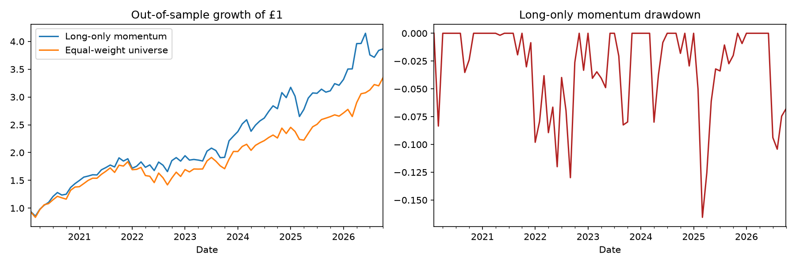

# Shariah-Aware Momentum Backtest

A long-only momentum strategy on a screened universe of large-cap US stocks, tested
out-of-sample with transaction costs and bootstrapped confidence intervals.

**Question:** can a simple momentum strategy that avoids short selling, leverage and
non-compliant business activities add value over holding the same stocks equally, and how much of
any apparent edge is distinguishable from luck?

> This is a research exercise, not a fatwa or investment advice. The screen is a first pass on
> business activity only. Financial-ratio screens (debt, interest income, etc.) are not applied.
> Verify every ticker with a screening service and a qualified scholar before relying on it.

## Strategy
Each month-end:
1. Rank stocks by trailing return over the past *L* months, **skipping the most recent month**
   (to avoid the short-term reversal effect, as in Jegadeesh & Titman, 1993).
2. Hold the top 30% equal-weighted. **Long-only: no short selling, no leverage.**
3. Hold for one month, then rebalance.

## Universe screen
Starting from 50 US large caps, the following are removed (see `universe.txt` for the final list):
- Conventional (interest-based) banks and insurers: JPM, BAC, WFC, GS, UNH, CVS
- Excluded conservatively pending verification: DIS, CMCSA, MCD, BA, VZ, T

The 30% portfolio size was fixed in advance, not tuned on results.

## What makes the evaluation honest
| Check | Why it matters |
|---|---|
| **Train/test split (60/40)** | The lookback is chosen on training data only; results are reported on untouched data. |
| **Transaction costs** | 10 bps charged on turnover; sensitivity shown at 0/10/25/50 bps. |
| **No look-ahead** | Weights set at month-end *t* earn returns over month *t+1*. |
| **Bootstrap CI on Sharpe** | A Sharpe ratio is an estimate, not a fact. 95% interval reported. |
| **Like-for-like benchmark** | Compared to an equal-weight portfolio of the same screened stocks. |
| **Cached data** | Prices are saved to `prices.csv` so every run is reproducible. |

## Run it
```bash
pip install -r requirements.txt
python backtest.py              # real data via yfinance (cached in prices.csv)
python backtest.py --synthetic  # simulated data, code test only
```
Outputs `results.png`, `results.csv` and `universe.txt`.

## Results
Out-of-sample period: [FIRST DATE] to October 2026 (the final 40% of the data).
Lookback chosen on training data only: 9 months.

| Strategy | Ann. return | Ann. vol | Sharpe | 95% CI (Sharpe) | Max drawdown |
|---|---|---|---|---|---|
| Long-only momentum (9m, net 10bps) | 23.1% | 17.3% | 1.29 | [0.56, 2.05] | -11.2% |
| Equal-weight screened universe | 19.5% | 15.6% | 1.23 | [0.48, 2.07] | -17.4% |



**Findings**
- Momentum returned more than the benchmark and had a shallower worst drawdown, but the Sharpe
  confidence intervals overlap almost entirely, so there is **no statistically significant edge**.
- Transaction costs barely mattered (Sharpe 1.32 at 0 bps, 1.18 at 50 bps).
- Training Sharpe ratios for the 3, 6, 9 and 12 month lookbacks (1.17, 1.29, 1.29, 1.15) were
  nearly identical, so the selected lookback is fragile.

## Known limitations (read these)
- **Survivorship bias**: the stock list is today's large caps, which excludes companies that
  failed or were dropped. This flatters returns, for the strategy and the benchmark.
- **Strong test period**: 2020 onwards was a very favourable market for large-cap growth stocks.
- **Screen is incomplete**: business-activity only. Debt, interest-income and cash ratios are
  not applied, and today's screening status is applied to past years, when a company may not have
  qualified.
- **Small universe** (36 stocks, so about 10 held at a time), so results are noisy and
  concentrated.
- **Parameter fragility**: the four lookbacks scored almost identically in training.
- **Costs are a flat assumption**; real costs depend on liquidity and spread.
- **Dividends**: any real-world investing would also need to consider purification of
  non-compliant income. Not modelled here.

## Ideas for extension
- Apply financial-ratio screens (debt / market cap, interest income share) using real data
- Use point-in-time index constituents to remove survivorship bias
- Test a larger universe and other markets (e.g. FTSE, via `.L` tickers)
- Regress returns on Fama-French factors to see if the result is just market and size exposure

## Stack
Python, pandas, NumPy, matplotlib, yfinance.
